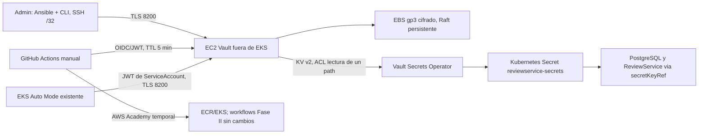

# FASE III — Evidencia de entrega: DevSecOps con HashiCorp Vault

**Alumno:** [Tu nombre]
**Materia:** [Nombre de la materia]
**Fecha:** [Fecha de entrega]
**Repositorio:** https://github.com/OnlineBoutique-DevOps/online-boutique-devops
**Rama:** `feature/fase3-vault-ansible`
**Cuenta AWS Academy:** `392730678728` — región `us-east-1`

---

## 0. Resumen ejecutivo

Esta entrega cubre **únicamente la Fase III**: la capa DevSecOps con HashiCorp Vault sobre la infraestructura de EKS ya existente.

Trabajo realizado:

- **Diseño y código** (dispositivo anterior): arquitectura documentada, Terraform aislado `terraform/vault/`, rol Ansible `vault_server`, políticas ACL, scripts de PKI/bootstrap/OIDC, manifiestos VSO, workflow `vault-smoke.yml` y runbook — todo versionado en `feature/fase3-vault-ansible`.
- **Despliegue y validación real** (este dispositivo): aprovisionamiento del EC2/EBS con Terraform, instalación de Vault 1.21.4 con Ansible, PKI/TLS, init/unseal, KV v2, ACLs, autenticación JWT para GitHub y para EKS, instalación de VSO, handoff gradual del Secret, pruebas negativas y runner self-hosted — todo sobre la cuenta AWS Academy `392730678728`.

Estado real verificado en infraestructura:

- `VaultStaticSecret` → `SecretSynced=True, Healthy=True, Ready=True`
- El Secret `reviewservice-secrets` ahora es propiedad de VSO (handoff Helm→VSO completado en etapas)
- 14 pods Running con credenciales rotadas provenientes de `kv/reviewservice`
- `vault-smoke.yml` ejecutado en verde con GitHub OIDC (run `38451749309`)
- Pruebas negativas ejecutadas: lectura denegada, token inválido, Vault sellado + recuperación
- Ansible idempotente verificado en el host real (3ª corrida `changed=0`)

Brechas declaradas honestamente: la restauración desde snapshot está documentada pero no ensayada; el runner self-hosted debe retirarse después de la demo (repo público).

---

## 1. Arquitectura y flujo de secretos



**Decisión clave:** Vault fuera de EKS para que el almacén de secretos no comparta el plano de fallo del clúster. Si EKS cae o se recrea, Vault y sus datos en EBS sobreviven.

> **[CAPTURA 1 — Consola AWS: EC2 de Vault]**
> Consola → EC2 → Instancias → `i-0cb07780f4d4fe65c` mostrando tipo `t3.small`, estado Running, y las pestañas Storage (2 volúmenes: root 8 GiB + datos 20 GiB cifrados) y Security (SG `sg-01eff9ed277a6e8b8`).

> **[CAPTURA 2 — Reglas del Security Group de Vault]**
> Consola → EC2 → Security Groups → reglas de entrada: TCP 8200 solo desde SG del clúster EKS + tu IP /32; TCP 22 solo desde tu IP /32. **Sin regla 0.0.0.0/0.**

---

## 2. Criterio 1: Seguridad de Vault, KV y políticas ACL (25 pts)

### 2.1 Vault funcional con TLS y Raft persistente

```bash
$ vault status       # en el EC2, sin mostrar tokens
Initialized             true
Sealed                  false
Total Shares            5
Threshold               3
Version                 1.21.4
Storage Type            raft
HA Enabled              true
```

- Listener HTTPS en `0.0.0.0:8200` con certificado propio (CA de laboratorio).
- Raft en volumen EBS gp3 cifrado dedicado (`/dev/nvme1n1` → `/opt/vault/data`).
- **Persistencia probada:** la instancia se detuvo y reinició; los datos de Raft sobrevivieron en el EBS (solo se requirió unseal).

### 2.2 Inicialización y unseal seguros

- Init real con 5 shares, umbral 3. La salida se cifró con GPG a una clave del operador y vive **fuera del repositorio** (`~/.local/state/online-boutique-vault/init-*.json.gpg`).
- El unseal se ejecutó 3 veces en la práctica: tras el despliegue, tras un restart de EC2 y tras el sello manual de la prueba negativa.

### 2.3 KV v2 y rutas de secretos

```bash
$ vault secrets list     # extracto
Path    Type    Description
kv/     kv      KV v2 - secretos de Online Boutique

kv/reviewservice → DB_PASSWORD, ADMIN_SECRET_KEY (rotados, valores no mostrados)
kv/ci/probe      → status=ready (canary no sensible)
```

### 2.4 Políticas de mínimo privilegio

| Política | Ruta | Capacidad |
|---|---|---|
| `reviewservice-vso` | `kv/data/reviewservice` | `read` solamente |
| `reviewservice-read` | `kv/data/reviewservice` | `read` solamente |
| `github-ci-probe` | `kv/data/ci/probe` | `read` solamente |

Archivos en `vault/policies/`. Sin policy asignada = acceso denegado por defecto.

### 2.5 Pruebas permitida / denegada / token inválido

Ejecutadas contra el Vault real:

```bash
# Permitido: policy github-ci-probe lee su ruta
$ vault kv get -field=status kv/ci/probe
ready        # (valor canary no sensible)

# Denegado: github-ci-probe intenta leer el secreto de la app
$ vault kv get kv/reviewservice
Error reading kv/data/reviewservice: permission denied

# Token inválido
$ VAULT_TOKEN=hvs.falso vault kv get kv/ci/probe
Error: permission denied
```

> **[CAPTURA 3 — Terminal: ACL permitida y denegada]**
> Una terminal mostrando la lectura permitida del probe y el `permission denied` al leer `kv/reviewservice` con el token del probe. Tapar cualquier token visible.

### 2.6 Credenciales de vida corta

- Rol `github-ci-probe` (mount `jwt/`): TTL 5 min, bound a repo + workflow + ref.
- Rol `reviewservice-vso` (mount `jwt-eks/`): JWT de ServiceAccount, expiración 600 s.
- Los valores antiguos de `helm-chart/values.yaml` se trataron como credenciales reales y **fueron rotados** en Vault antes del handoff; el chart ya no escribe el Secret.

### 2.7 Expiración de token y cambio de política ACL

Ejecutadas contra el Vault real:

```bash
# Token con TTL=20s
$ vault kv get -field=status kv/ci/probe   # con token vivo
ready
# ...35 segundos después, mismo token:
$ vault kv get -field=status kv/ci/probe
Code: 403. permission denied / invalid token     # expirado = inútil

# Cambio de política en caliente (token sigue vivo, misma identidad):
$ vault kv get -field=DB_PASSWORD kv/reviewservice   # policy=read → <valor leído>
$ vault policy write reviewservice-vso → capabilities=["deny"]
$ vault kv get -field=DB_PASSWORD kv/reviewservice   # → Code: 403 permission denied
$ vault policy write reviewservice-vso → capabilities=["read"]  (restaurada)
$ vault kv get -field=DB_PASSWORD kv/reviewservice   # → <valor leído>
```

Demuestra: (a) los tokens expiran y dejan de servir solos; (b) una modificación de política tiene efecto inmediato sobre identidades ya autenticadas — el control de acceso vive en Vault, no en el cliente.

### 2.8 Destrucción y recreación del entorno (idempotencia end-to-end)

Ejecutado en vivo: `terraform destroy -target=aws_instance.vault -target=aws_volume_attachment.vault_data` eliminó la EC2; el volumen EBS de datos sobrevivió gracias a `prevent_destroy`. Luego `terraform apply` creó la instancia nueva (`i-073c6a2e8d7200925`) y re-attachó el mismo volumen.

Resultados en la instancia recreada:

- `ansible-playbook site.yml` instaló Vault completo desde cero (`changed=11`), y la tarea de guardia **detectó el filesystem XFS existente en el EBS y no reformateó** (`skipped=1`) — la protección anti-formato funciona.
- `vault operator unseal` con **las mismas 3 shares** → `Sealed: false`, mismo `Cluster ID 7e1cf542-b8c7-f79f-fb33-956b7535e0cb` → los datos Raft sobrevivieron a la destrucción de la instancia.
- Al cambiar la IP privada, se reemitió el certificado con los nuevos SAN (la CA no cambió → el Secret `vault-ca` siguió válido) y se actualizó el `VaultConnection` → VSO volvió a `SecretSynced=True Ready=True`.

Esto demuestra que el entorno se destruye y recrea desde código (Terraform + Ansible), y que los secretos persisten en el volumen dedicado independientemente de la instancia.

### 2.9 Prueba de Vault sellado y recuperación

Ejecutada en producción del laboratorio:

```bash
$ vault operator seal            # como root en el EC2
Success! Vault is sealed.

# VSO reacciona en el clúster:
$ kubectl get vaultstaticsecret reviewservice-secret-sync
# → SecretSynced=False  Healthy=False  Ready=False
# Evento: "Failed to get Vault auth login ... Vault is sealed" (503)

# Mientras tanto:
$ kubectl get secret reviewservice-secrets      # EXISTE (último dato conocido retenido)
$ kubectl get pods                               # 14/14 Running — la app sobrevive

# Recuperación:
$ vault operator unseal ×3 shares
# → VSO resincroniza SOLO: SecretSynced=True Healthy=True Ready=True
```

> **[CAPTURA 4 — `kubectl get vaultstaticsecret` durante el sello]**
> Mostrando `SecretSynced=False` con el evento "Vault is sealed" en `kubectl describe`.

> **[CAPTURA 5 — `kubectl get pods` durante el sello]**
> Los 14 pods Running mientras Vault está sellado — demuestra que el Secret retenido mantiene viva la app.

> **[CAPTURA 6 — `VaultStaticSecret` recuperado tras unseal]**
> `SecretSynced=True Healthy=True Ready=True` después del unseal.

---

## 3. Criterio 2: UI y acceso seguro (25 pts)

- `ui = true` habilitado en `vault.hcl` (Ansible `vault.hcl.j2`).
- Servida **solo por HTTPS** con el certificado propio; `skipTLSVerify: false` en todos los clientes (VSO y vault-action).
- Reglas de red: 8200 limitado al SG del clúster EKS + /32 del administrador; SSH 22 solo al /32. **Nunca expuesta a 0.0.0.0/0.**
- Acceso administrativo: SSH con clave propia `vault-admin` restringido por SG a una sola IP. Se documentó por qué no se usó SSM (AWS Academy no ofrece instance profile gestionable para el rol de laboratorio).

> **[CAPTURA 7 — UI de Vault en el navegador]**
> Abrir `https://<DNS-público-del-EC2>:8200` desde tu IP permitida. Acepta el warning del certificado (CA propia — captura también el detalle del cert si quieres sumar). Captura la pantalla de login. **No captures el root token ni hagas login con él visible.**

> **[CAPTURA 8 — Vista de secrets en la UI]**
> Tras login (usa el root token o un token temporal — pídeme uno corto si prefieres), ir a Secrets → `kv/` mostrando `reviewservice` y `ci/probe`. La UI no muestra valores sin hacer clic — captura solo la lista de rutas.

---

## 4. Criterio 3: Portafolio de evidencias (25 pts)

Este documento organiza las evidencias por criterio. Inventario de capturas:

| # | Captura | Criterio | Dónde obtenerla |
|---|---|---|---|
| 1 | EC2 de Vault (estado, volúmenes, SG) | 1, 2 | Consola AWS → EC2 |
| 2 | Reglas del Security Group | 2 | Consola AWS → EC2 → SG |
| 3 | ACL permitida + denegada en terminal | 1 | SSH al EC2 con `vault` |
| 4 | VSS `SecretSynced=False` al sellar | 1 | `kubectl describe` (ya ejecutado; repetible) |
| 5 | 14 pods Running durante el sello | 1, 4 | `kubectl get pods` |
| 6 | VSS `Ready=True` tras unseal | 1, 4 | `kubectl get vaultstaticsecret` |
| 7 | Login UI por HTTPS | 2 | Navegador → `https://<EC2-DNS>:8200` |
| 8 | Lista de secretos `kv/` en UI | 2 | UI → Secrets |
| 9 | `kubectl get vaultstaticsecret` Ready | 4 | Terminal kubectl |
| 10 | Secret con ownerReference = VSO | 4 | `kubectl get secret reviewservice-secrets -o yaml` (tapar `data:`) |
| 11 | Ansible 3ª corrida `changed=0` | 4 | PLAY RECAP en terminal WSL |
| 12 | Run verde de `vault-smoke.yml` | 1, 4 | GitHub Actions → run `38451749309` |
| 13 | Run rojo previo (rama no autorizada) | 1 | GitHub Actions → run `38451469882` |
| 14 | App funcionando con secretos servidos por Vault | 4 | `http://<IP-nodo>:30576` |

> **[CAPTURAS 9–14 — ver tabla]**
> Insertar cada captura junto a su número. Para la 10, tapar la sección `data:` del YAML (son los valores reales cifrados en base64).

---

## 5. Criterio 4: Entregables del repositorio (25 pts)

| Entregable | Ubicación | Estado |
|---|---|---|
| README con estado real | `README.md` | ✅ |
| Runbook reproducible + matriz | `docs/fase3-runbook.md` | ✅ |
| Diseño + diagrama + costos | `docs/fase3-fase1-diseno.md` | ✅ |
| Terraform aislado de Vault | `terraform/vault/` (estado local, separado) | ✅ |
| Rol Ansible modular + deps fijadas | `ansible/roles/vault_server/`, `ansible/requirements.yml` | ✅ |
| Políticas ACL | `vault/policies/` | ✅ |
| Workflow de smoke OIDC | `.github/workflows/vault-smoke.yml` | ✅ |
| Manifiestos VSO | `kubernetes/vault-secrets-operator/` | ✅ |
| Helm con handoff por etapas | `helm-chart/` (`vaultSecrets.*`) | ✅ |

### Pruebas clave reproducibles

```bash
# Sincronización VSO (sin mostrar valores)
kubectl get vaultstaticsecret reviewservice-secret-sync -o yaml

# Claves del Secret sin exponer datos
kubectl get secret reviewservice-secrets -o jsonpath='{.data}' | grep -o '"[A-Z_]*":'
# → "ADMIN_SECRET_KEY": "DB_PASSWORD":

# Rollout saludable
kubectl rollout status deployment/reviewservice
kubectl rollout status deployment/postgres-review-db
```

### GitHub OIDC → Vault (vault-smoke.yml)

- Runner self-hosted `vault-ec2-runner` (etiqueta `vault-network`) en el propio EC2 de Vault — los runners hospedados en GitHub no tienen ruta a un endpoint privado.
- El workflow pide el id-token OIDC de GitHub, `hashicorp/vault-action` lo intercambia en el mount `jwt/` por un token de 5 min con la policy `github-ci-probe`, lee `kv/ci/probe` y verifica `status=ready` **sin imprimirlo**.
- El workflow se dispara por `workflow_dispatch` **y por `push`** a `main`/`feature/fase3-vault-ansible` cuando cambian archivos de Vault/VSO — el commit que agregó el trigger ejecutó el pipeline automáticamente.
- Runs en verde: `38451749309` (dispatch) y el run 38811523676 por push. Run rojo previo (`38451469882`) rechazado por `workflow_ref` no ligado — evidencia de que el binding funciona.

> **[CAPTURA 11–13 — ver tabla]**

---

## 6. Inventario de identidades, rutas y permisos

| Identidad | Autenticación | Política | Alcance |
|---|---|---|---|
| Operador (break-glass) | root token cifrado GPG fuera del repo | root | init/unseal/emergencias |
| Admin SO | SSH key `vault-admin`, SG /32 | — | Ansible, mantenimiento |
| GitHub Actions | JWT OIDC mount `jwt/`, rol `github-ci-probe`, bound repo+workflow+ref, TTL 5 min | `github-ci-probe` | `kv/data/ci/probe` read |
| VSO (pod) | JWT de SA `default/reviewservice-vault-reader`, mount `jwt-eks/`, rol `reviewservice-vso`, aud `vault` | `reviewservice-vso` | `kv/data/reviewservice` read |

---

## 7. Recursos AWS creados en Fase III y costos

**Creados por `terraform/vault/` y la configuración de esta fase:**

| Recurso | Detalle | Costo est. |
|---|---|---|
| EC2 Vault `i-0cb07780f4d4fe65c` | t3.small, IMDSv2, IP pública | ~$0.03/h (~$21/mes) |
| EBS | root 8 GiB + gp3 datos 20 GiB cifrados | ~$2/mes |
| SG Vault `sg-01eff9ed277a6e8b8` | 8200 solo SG-EKS + admin /32; 22 solo admin /32 | — |
| Key pair `vault-admin` | clave privada fuera del repo | — |
| Runner Actions `vault-ec2-runner` | servicio systemd en el EC2 de Vault | $0 |
| Objetos en Vault | mounts `jwt/`+`jwt-eks/`, KV v2, 3 policies, 2 roles | $0 |
| Objetos en Kubernetes | release VSO 1.6.0, CRDs, VaultConnection/Auth/StaticSecret | $0 |

**Preexistentes de Fase II sobre los que Vault opera (no creados en esta fase):**

| Recurso | Detalle |
|---|---|
| EKS `online-boutique-cluster` | Auto Mode, k8s 1.34, ~$0.10/h + nodos |
| 13 repos ECR | `online-boutique/*` |
| Secret `reviewservice-secrets` | migrado de Helm a VSO en esta fase |
| S3 + DynamoDB | backend Terraform |

**Costo incremental de Fase III:** ~$23/mes (EC2 + EBS + IPv4). El costo dominante del lab sigue siendo el control plane EKS heredado de Fase II.

---

## 8. Defensa oral — respuestas en una línea

- **¿Por qué Vault fuera de EKS?** El almacén de secretos no comparte el plano de fallo del clúster; sobrevive a recreación de EKS y también sirve a CI/CD externo.
- **¿Qué automatiza Ansible?** Instala Vault 1.21.4 fijado, TLS/UI/Raft, monta el EBS verificando el dispositivo antes de formatear; idempotente (`changed=0` en re-ejecución).
- **¿Cómo se autentica GitHub?** OIDC: GitHub firma un JWT efímero, Vault lo valida con bound repo+workflow+ref y devuelve un token de 5 min. No hay token estático en GitHub.
- **¿Cómo entrega VSO?** El ServiceAccount del pod presenta su JWT a `jwt-eks/` → token corto → lee `kv/reviewservice` → materializa el Secret nativo; la app usa `secretKeyRef` sin cambios.
- **¿Qué pasa si Vault falla?** Probado: VSO marca `SecretSynced=False`, el Secret queda con el último dato y la app sigue viva; al recuperar, resincroniza solo. Es punto único de fallo → mitigado con EBS persistente + procedimiento de snapshot.

---

## 9. Brechas declaradas (honestidad de la entrega)

| Brecha | Por qué | Mitigación |
|---|---|---|
| Restore desde snapshot no ensayado | Requiere instancia aislada de recuperación; procedimiento documentado en runbook | Datos en EBS persistente probados tras stop/start |
| Runner self-hosted temporal | Repo público; solo `workflow_dispatch` puede usarlo | Retirar con `sudo ./svc.sh uninstall` tras la demo |
| La IP pública del EC2 cambia tras stop/start | AWS Academy sin Elastic IP | SANs estables (hostname privado) para VSO; para la UI aceptar el warning de cert |
