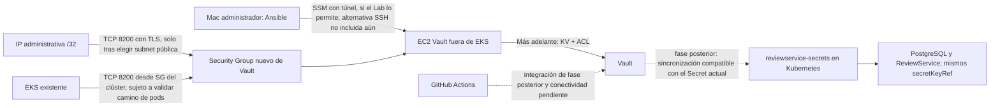

# Fase III - Fase 1: diseño e infraestructura

**Estado:** propuesta de diseño; sin despliegue ni consulta en vivo a AWS.

**Base revisada:** `main`, commit `57df18db`.

**Contexto de costos:** AWS Academy Learner Lab, límite indicado de USD 50.

## 1. Arquitectura actual comprobada en archivos

El Terraform de la Fase II consulta una VPC y subredes ya existentes, declara el clúster EKS con Auto Mode y `metrics-server`, y administra 13 repositorios ECR. El backend de la configuración principal es S3 con bloqueo DynamoDB. No encontré EC2 dedicada a Vault, grupos de seguridad de Vault, Ansible ni recursos Vault. Los comentarios del Terraform dicen que los roles usados por EKS pertenecen al laboratorio y que no se crean aquí por restricciones de IAM.

El pipeline despliega el chart `helm-chart/` en EKS. El chart crea el Secret Kubernetes `reviewservice-secrets`; PostgreSQL y ReviewService consumen sus claves por referencias `secretKeyRef`. Los valores de aplicación se originan en `helm-chart/values.yaml`. La propuesta mantiene ese contrato de Kubernetes en esta fase de diseño.

Referencias revisadas: `terraform/main.tf`, `terraform/variables.tf`, `terraform/providers.tf`, `terraform/output.tf`, `.github/workflows/ci.yml`, `.github/workflows/deploy.yml`, `helm-chart/templates/secret.yaml`, `helm-chart/templates/reviewservice.yaml`, `helm-chart/templates/postgresql.yaml` y `helm-chart/values.yaml`.

## 2. Propuesta de infraestructura

Crear una configuración Terraform separada en `terraform/vault/` para evitar mezclar el ciclo de vida y el estado del clúster de Fase II con el host de Vault. La propuesta declara:

- Una EC2 `t3.small` con Amazon Linux 2023, fuera de EKS, en una subnet existente de la VPC existente.
- Volumen raíz gp3 de 8 GiB cifrado, volumen EBS gp3 separado de 20 GiB para Raft (con `prevent_destroy`) y metadatos IMDSv2 obligatorios.
- Un Security Group nuevo adjunto solamente al host Vault.
- Sin VPC, NAT Gateway, ALB, runner, IAM role, Instance Profile ni SSM endpoints nuevos.
- Terraform crea el host y el volumen persistente; la instalación de software queda en el rol Ansible de `ansible/`.

Los IDs de VPC/subnet, el SG del clúster y el CIDR del administrador quedan como variables obligatorias: deben confirmarse en Learner Lab y no se inventan desde la configuración histórica.

### Diagrama

La flecha administrativa por IP pública requiere `assign_public_ip=true`, subnet pública y TLS configurado. El valor por defecto en Terraform es `false`; en ese estado la administración requiere una vía privada (por ejemplo, SSM validado). No se debe aplicar la regla hasta decidir y comprobar la vía elegida.

## 3. Reglas de red propuestas

| Dirección | Protocolo/puerto | Origen/destino | Propósito y condición |
|---|---|---|---|
| Entrada | TCP 8200 | CIDR administrativo único `/32` | UI/API de Vault. Solo con TLS y acceso público aprobado; no `0.0.0.0/0`. |
| Entrada | TCP 8200 | Security Group EKS existente | Clientes dentro del clúster. Validar si ese SG realmente cubre el tráfico de pods/CNI. |
| Entrada | TCP 22 | Ninguno | No se declara SSH en la propuesta. |
| Salida | TCP 443 | Internet mediante la ruta existente | Descargas de paquetes y futuras verificaciones OIDC; validar que la ruta ya exista, sin crear NAT. |
| Salida | UDP/TCP 53 | CIDR de la VPC | Resolución DNS del host. |

Con SSM, el agente inicia conexiones salientes HTTPS y no hace falta abrir SSH ni puertos entrantes de administración. Sin embargo, SSM requiere permisos en un rol de instancia existente y conectividad con sus servicios; no hay perfil IAM ni endpoints declarados aquí. La propuesta no presupone que el Learner Lab permita crearlos.

## 4. Inventario para migración a Vault

Solo se registran nombres, ubicaciones y uso. No se copian valores al portafolio. Antes de migrar hay que verificar si los valores actuales son marcadores o credenciales reales y, si fueron usados, rotarlos.

| Nombre | Ubicación comprobada | Uso / decisión propuesta |
|---|---|---|
| `DB_PASSWORD` | `.Values.database.password` en `helm-chart/values.yaml`; expuesto como clave de `reviewservice-secrets` en `helm-chart/templates/secret.yaml` | PostgreSQL y ReviewService. Migrar a un path KV de aplicación con lectura solo para el consumidor autorizado; conservar nombre de clave Kubernetes inicialmente. |
| `ADMIN_SECRET_KEY` | `.Values.auth.adminSecretKey` en `helm-chart/values.yaml`; expuesto como clave de `reviewservice-secrets` | ReviewService. Migrar a path KV separado o campo con política de lectura mínima. |
| `AWS_ACCESS_KEY_ID` | Referencia `${{ secrets.AWS_ACCESS_KEY_ID }}` en workflows CI, CD y release | Credencial temporal de AWS Academy para publicar en ECR, desplegar en EKS y crear release. No migrar automáticamente a KV; preferir OIDC AWS si IAM/Lab lo permite, en caso contrario mantener la rotación temporal documentada. |
| `AWS_SECRET_ACCESS_KEY` | Referencia `${{ secrets.AWS_SECRET_ACCESS_KEY }}` en los mismos workflows | Parte de la sesión temporal AWS Academy; mismo uso y decisión que la anterior. |
| `AWS_SESSION_TOKEN` | Referencia `${{ secrets.AWS_SESSION_TOKEN }}` en los mismos workflows | Token temporal requerido junto con las credenciales del Lab; caduca por sesión. |
| `GOOGLE_API_KEY` | Placeholder en overlay opcional `kustomize/components/shopping-assistant/shoppingassistantservice.yaml` | Solo aplica a la integración opcional de Shopping Assistant con Google; no forma parte del despliegue Helm actual de EKS según el workflow. Inventariar si se activa ese overlay. |
| `ALLOYDB_SECRET_NAME` | Placeholder en `kustomize/components/alloydb/kustomization.yaml` y overlay relacionado | Nombre/referencia de secreto para la integración opcional AlloyDB; no es el secreto del despliegue Helm principal. Investigar antes de incluirlo en Vault. |

En el baseline de Fase II no había componentes Vault, políticas, engine KV, Ansible ni autenticación. La implementación local posterior está descrita en `docs/fase3-runbook.md`. `helm-chart/values.yaml` contiene predeterminados con forma de credenciales; por seguridad no se reproducen aquí. Determinar si son placeholders o se desplegaron y rotarlos si eran secretos reales. La migración mantiene el comportamiento Helm anterior por defecto y se activa de forma explícita.

## 5. Costos y supuestos

Estimación indicativa en USD para Linux bajo demanda en `us-east-1`, mes de 730 horas, sin impuestos, tráfico, transferencias, descuentos ni reglas especiales de Learner Lab. Los precios pueden variar. Consultar [T3](https://aws.amazon.com/ec2/instance-types/t3/), [gp3](https://docs.aws.amazon.com/prescriptive-guidance/latest/optimize-costs-microsoft-workloads/ebs-migrate-gp2-gp3.html) y [precios VPC/IPv4/NAT](https://aws.amazon.com/vpc/pricing/) antes de solicitar despliegue.

| Recurso/alternativa | Por hora aproximado | Por mes aproximado | Supuesto / riesgo presupuestario |
|---|---:|---:|---|
| `t3.small` EC2 | 0.0209 | 15.26 | Encendida 730 h; CPU sostenida fuera de baseline puede sumar cargos T3 Unlimited. |
| gp3 total 28 GiB (raíz 8 + Raft 20) | 0.0031 equivalente | 2.24 | Se cobra por GiB-mes; ambos volúmenes persisten mientras existan, aunque EC2 esté detenida. El volumen de datos tiene protección Terraform contra destrucción accidental. |
| IPv4 pública de EC2 | 0.0050 | 3.65 | Solo si se asigna durante todo el mes; evitar Elastic IP o IP ociosa y confirmar tarifa actual. |
| Total EC2 + 28 GiB + IPv4 | 0.0290 promedio | 21.15 | Escenario de subnet pública; suma antes de datos, transferencias e impuestos. |
| EC2 + discos, sin IPv4 | 0.0240 promedio | 17.50 | Requiere acceso privado; endpoints SSM, si fueran necesarios, cuestan aparte. |
| Tres endpoints SSM (estimación regional) | 0.0300 | 21.90 | Aproximación a USD 0.01/h por endpoint, sin procesamiento; sumar a EC2 privada da cerca de USD 39.40/mes. Confirmar endpoints y precio/AZ del Lab. |
| NAT Gateway, alternativa desaconsejada | 0.0450 | 32.85 | Cargo horario base, más procesamiento, IPv4 y transferencia. Junto con EC2 propuesta excedería USD 50/mes. |
| Administrar Ansible desde Mac | 0 | 0 | No añade cómputo AWS. |

Un uso de demostración de 100 horas con `t3.small`, 28 GiB de gp3 por el mes e IPv4 durante esas 100 horas rondaría USD 4.83, si la IP solo se factura ese tiempo. Detener EC2 reduce cómputo; los volúmenes conservan cargo. Vault OSS no añade licencia según esta estimación.

**Costo existente que puede dominar el presupuesto:** el precio de control plane EKS en soporte estándar es aproximadamente USD 0.10/h (USD 73 por 730 h), independiente de nodos y del cargo de administración de Auto Mode. El Terraform fija Kubernetes 1.34 y soporte STANDARD; AWS anuncia que 1.34 sale de soporte estándar el 2 de diciembre de 2026, cuando el precio de soporte extendido listado es USD 0.60/h (USD 438/mes de control plane si permanece todo el mes). Son cargos condicionales: no se comprobó el estado activo ni la factura de la cuenta. Verificar costos actuales de EKS antes de añadir recursos. Referencias: [precios EKS](https://aws.amazon.com/eks/pricing/) y [ciclo de versiones EKS](https://docs.aws.amazon.com/eks/latest/userguide/kubernetes-versions.html).

## 6. Validaciones previas a cualquier despliegue

- Revisar presupuesto y consumo actual de EKS, nodos Auto Mode, ECR, IPv4 y almacenamiento en Learner Lab.
- Confirmar permisos y cuotas de EC2, EBS, Security Groups y AMI; confirmar subnet seleccionada, rutas, DNS y espacio de IP.
- Validar si está permitido un rol de instancia preexistente apto para SSM. Si no, aprobar método administrativo alterno antes de habilitar una IP.
- Confirmar que el SG de EKS es un origen correcto para tráfico de los pods que consultarían Vault.
- Configurar TLS antes de habilitar UI/API; mantener Vault en subnet privada si la administración SSM está disponible.
- Definir almacenamiento y procedimiento protegido de init/unseal; no guardar root token, recovery/unseal keys o credenciales en Git, logs ni capturas.
- Confirmar autenticación y conectividad para GitHub Actions en fases posteriores; runners GitHub-hosted no alcanzan un endpoint privado sin una ruta de red diseñada.
- Determinar si los valores actuales del chart llegaron a entornos reales; rotar credenciales reales expuestas.

## 7. Entregables y estado

| Entregable de Fase 1 | Estado |
|---|---|
| Inspección de Terraform y arquitectura Fase II | Completada desde archivos; sin inspección de cuenta AWS en vivo. |
| Propuesta Terraform para EC2 dedicada y SG restringido | Preparada en `terraform/vault/`; no inicializada, planificada ni aplicada. |
| Inventario de nombres/rutas/usos para migración | Documentado sin valores. |
| Arquitectura, flujo y portafolio/evidencias | Documentados en este archivo; diagrama Mermaid incluido. |

El estado actualizado de las cuatro fases, validaciones y bloqueos está en [docs/fase3-runbook.md](fase3-runbook.md). La propuesta de Fase 1 se amplió después para proteger los datos Raft en un volumen EBS separado; no se ha desplegado.
