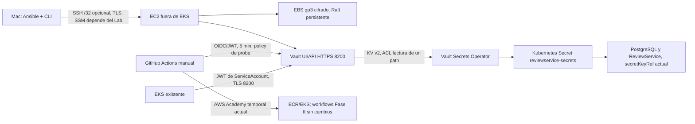

# Fase III DevSecOps: implementación, validación y evidencias

Este runbook refleja lo implementado en el repositorio y separa claramente lo no probado. No se han creado recursos en AWS ni se ha desplegado nada en EKS. Los pasos remotos de este documento son instrucciones futuras; no ejecutarlos hasta contar con presupuesto, permisos y aprobación para el despliegue.

## Arquitectura



La autenticación GitHub→Vault y EKS→Vault usa roles JWT separados y montajes separados. Ninguno necesita un proveedor OIDC de IAM de AWS. GitHub-hosted runners no tienen ruta a un Vault privado: el smoke test exige un runner confiable `self-hosted` con la etiqueta `vault-network`. No se configura ni instala un runner.

## Fase 1: infraestructura

Implementado en `terraform/vault/`: EC2 `t3.small`, volumen raíz cifrado de 8 GiB, EBS gp3 cifrado separado de 20 GiB para Raft con `prevent_destroy`, Security Group dedicado, IMDSv2 y salida limitada a HTTPS/DNS. Solo consulta VPC/subnet existentes. `assign_public_ip` y `enable_ssh` están apagados por defecto. No incluye NAT, load balancer, rol IAM ni SSM endpoints.

Costo indicativo: alrededor de USD 21.15/mes con la instancia encendida 730 h, 28 GiB de gp3 y una IPv4 pública todo el mes; sin IPv4, cerca de USD 17.50/mes. Más detalles y supuestos en [el diseño de Fase 1](fase3-fase1-diseno.md). El costo actual de EKS puede superar el crédito incluso antes de estos recursos.

Bloqueos de Learner Lab resueltos en la práctica: EC2, EBS, SG, AMI y key pair propio sí fueron permitidos; SSM no se usó (sin instance profile gestionable) y se documentó SSH restringido como alternativa.

Comprobaciones futuras, desde `terraform/vault/` y con variables locales ignoradas por Git:

Se ejecutó `terraform fmt` con Terraform 1.16.5, `terraform fmt -check` y `terraform validate` con Terraform 1.14.9, e `init -backend=false` con AWS provider 5.100.0. La ejecución inicial de `validate` dentro del sandbox no pudo iniciar el proceso local del provider; al repetirla con permisos locales ampliados pasó. La versión de trabajo queda fijada en `terraform/vault/.terraform-version`. La inicialización no configuró backend remoto ni consultó AWS.

Ya se ejecutó `terraform plan` y `apply` contra la cuenta real (392730678728): el plan mostró únicamente Security Group, EC2 `t3.small`, EBS gp3 y su attachment — ningún recurso de EKS/ECR — y se aplicó con estado local independiente en `terraform/vault/` (protegido, ignorado por Git). `assign_public_ip=true` y `enable_ssh` se activaron para esta entrega porque SSM no era viable sin instance profile gestionable; el acceso quedó restringido al /32 del administrador. El volumen `prevent_destroy` reduce el riesgo de borrado accidental, pero no sustituye respaldos.

### Respaldo y recuperación de Raft

Vault de un solo nodo es un punto único de fallo. El EBS persistente protege contra la terminación accidental de EC2, pero no contra pérdida/corrupción del volumen. Un snapshot Raft contiene datos confidenciales cifrados por Vault; guárdalo fuera del repositorio, en una ubicación con acceso limitado y cifrado/retención aprobados. El token operador y las shares de unseal se custodian por separado. Este procedimiento está documentado, pero aún no se ha probado restaurando un clúster.

Con Vault inicializado y desprecintado, una sesión autenticada con permisos administrativos para snapshots y una ruta local aprobada fuera del checkout:

```sh
umask 077
: "${VAULT_BACKUP_DIR:?Define un directorio de respaldo seguro fuera del repositorio}"
mkdir -p "$VAULT_BACKUP_DIR"
chmod 700 "$VAULT_BACKUP_DIR"
repo_root="$(cd "$(git rev-parse --show-toplevel)" && pwd -P)"
backup_dir="$(cd "$VAULT_BACKUP_DIR" && pwd -P)"
case "$backup_dir/" in
  "$repo_root/"*) echo "El respaldo debe quedar fuera del repositorio." >&2; exit 2 ;;
esac
snapshot="$VAULT_BACKUP_DIR/vault-$(date -u +%Y%m%dT%H%M%SZ).snap"
test ! -e "$snapshot"
vault operator raft snapshot save "$snapshot"
chmod 600 "$snapshot"
vault operator raft snapshot inspect "$snapshot"
```

Transfiere el archivo a almacenamiento externo cifrado y con acceso restringido, confirma que la copia se puede leer/verificar y aplica una política de retención; no lo añadas al repositorio ni a artefactos CI. Conserva junto a la copia (en un gestor aprobado, no en el mismo directorio) versión/configuración de Vault y la referencia a custodios de las shares originales. `snapshot inspect` verifica que el archivo es legible, pero no demuestra una restauración correcta. Referencias oficiales: [guardar snapshot](https://developer.hashicorp.com/vault/docs/sysadmin/snapshots/save) y [restaurar snapshot](https://developer.hashicorp.com/vault/docs/sysadmin/snapshots/restore).

La recuperación debe ensayarse primero en un host y red aislados. Aprovisiona Vault con versión/configuración compatibles y almacenamiento vacío; inicializa esa instancia aislada y desprecíntala con su material temporal para poder autenticarse. Copia allí el snapshot aprobado y restaura con `vault operator raft snapshot restore -force /ruta/segura/vault-<fecha>.snap` solo si la instancia destino fue inicializada con nuevas shares, como requiere una restauración forzada. **Este comando reemplaza el estado de Vault destino; no ejecutarlo en el servicio activo como experimento.** Espera la finalización de la recuperación en logs antes de operar; tras la restauración, desprecinta con las shares originales correspondientes al snapshot y valida estado, mounts, políticas y una lectura canary sin mostrar datos. El token temporal de la instancia de recuperación ya no representa el estado restaurado. Practicar esta secuencia y medir RPO/RTO sigue pendiente; un snapshot no probado no es evidencia de recuperación.

## Fase 2: Ansible

Implementado en `ansible/`: `site.yml`, rol `vault_server`, instalación desde el repositorio RPM oficial con Vault fijado a 1.21.4, servicio systemd, listener TLS obligatorio, UI habilitada y almacenamiento integrado Raft sobre el volumen EBS montado. El rol falla cerrado si falta TLS real, conserva host key checking, no registra la clave privada (`no_log`) y evita reformatear un volumen que tenga un filesystem distinto de `VAULT_DATA`. La colección externa `ansible.posix` está fijada en 1.6.2 en `ansible/requirements.yml`; `mount` pertenece a esa colección y no a `ansible-core`.

Preparación local cuando exista EC2, DNS y PKI:

1. Ejecuta `scripts/vault/create-local-pki.sh <FQDN-Vault>`; la CA privada requiere passphrase y los archivos se guardan por defecto fuera del repositorio, bajo el directorio de configuración local. No copies ninguna clave al checkout.
2. Proporciona rutas con `VAULT_TLS_CERT`, `VAULT_TLS_KEY` y `VAULT_TLS_CA`; copia los ejemplos de inventario y variables únicamente si los archivos destino no existen. El inventario privado es ignorado por Git. Instala la dependencia fijada desde `ansible/` con `ansible-galaxy collection install -r requirements.yml`.
3. Revisa conectividad por SSM o habilita, con aprobación aparte, SSH/22 limitado a tu `/32` y el key pair preexistente. Ansible no abre puertos.
4. Confirma con `lsblk` cuál nombre NVMe corresponde al EBS de datos y ajusta `vault_data_device` localmente si no es `/dev/nvme1n1`.
5. La comprobación `ansible-playbook --syntax-check -i inventory/hosts.example.yml site.yml` pasó con Ansible Core 2.15.13 y `ansible.posix` 1.6.2. No se ejecutó `--check` ni una segunda corrida: el rol requiere una instancia Linux, systemd, DNF y un EBS real; además, primero debe confirmarse el dispositivo de datos para no formatear el disco equivocado. La idempotencia queda preparada por módulos declarativos, pero no está demostrada hasta ejecutar dos corridas autorizadas sobre el host. `ansible-lint` no se instaló ni se ejecutó.

Las tareas `mkfs`/mount requieren que el EBS ya esté adjunto. No se conectó Ansible a AWS y no se usaron credenciales ni PKI reales.

## Fase 3: Vault, KV, ACL y GitHub Actions

Implementado en `vault/policies/` y `scripts/vault/`. El motor propuesto es KV v2 en `kv/`. La policy `reviewservice-read` solo lee `kv/data/reviewservice`; `github-ci-probe` solo lee `kv/data/ci/probe`; `reviewservice-vso` tiene lectura de la ruta de aplicación. `configure-github-auth.sh` crea el backend GitHub JWT y rol ligado al repositorio, `main`, workflow específico y TTL máximo de cinco minutos. `configure-vso-auth.sh` configura un segundo backend JWT ligado a un único ServiceAccount y audience.

La inicialización captura el JSON de shares/token directamente a GPG cifrado fuera del repositorio y no lo muestra en pantalla. Requiere un destinatario público GPG previamente preparado; recuperar material requiere la clave privada correspondiente. Nunca introduzcas root token/unseal shares en GitHub. Desprecinta Vault interactivamente con las shares guardadas por separado y reduce/elimina el uso del root token después del bootstrap.

Tras importar credenciales válidas desde una fuente aprobada, configura variables de entorno `VAULT_ADDR`, `VAULT_CACERT` y `VAULT_TOKEN` usando un token operador corto; no pegues su valor en comandos guardados en el historial. Ejecuta los scripts solo contra el Vault correcto después de comprobar `vault status`. Inicializa el canary no sensible `kv/ci/probe` con `status=ready`. Los valores de aplicación se migran manualmente desde el gestor de credenciales, nunca desde `values.yaml` por automatización ciega.

`.github/workflows/vault-smoke.yml` es `workflow_dispatch`, restringe permisos a `contents: read` e `id-token: write`, usa `hashicorp/vault-action` v4.0.0 fijada al SHA íntegro del release firmado y no imprime la respuesta recuperada. La audience configurada en Vault (`https://github.com/OnlineBoutique-DevOps`) coincide con el valor predeterminado documentado por la acción; cambiar `jwtGithubAudience` exigiría actualizar `bound_audiences`. Requiere variables GitHub `VAULT_ADDR` y `VAULT_CA_CERT`, rol Vault configurado y runner confiable con etiqueta `vault-network`; al usar Node 24, ese runner debe tener una versión de Actions Runner que lo soporte. El workflow CD conserva AWS Academy temporal y ahora lee `VAULT_SECRETS_ENABLED` desde GitHub Variables, con valor predeterminado `false`; no se activó.

La autenticación GitHub→Vault es independiente de AWS. Los workflows existentes de CI/CD obtienen `AWS_ACCESS_KEY_ID`, `AWS_SECRET_ACCESS_KEY` y `AWS_SESSION_TOKEN` de GitHub Actions Secrets, cargados por el operador desde las credenciales temporales de AWS Academy Learner Lab. El session token expira con la sesión del laboratorio; el operador debe renovar los tres valores en GitHub Secrets al iniciar una sesión nueva y antes de volver a ejecutar jobs AWS. La federación directa GitHub→AWS no está configurada porque no se han confirmado permisos para crear IAM/OIDC en Learner Lab. No se guarda la credencial AWS en Vault ni se supone que el OIDC de Vault otorgue permisos AWS. Esta es una solución de transición y su operación real no se ha verificado en esta revisión.

## Fase 4: Kubernetes y pruebas

Implementado como manifiestos preparatorios en `kubernetes/vault-secrets-operator/`. Se propone Vault Secrets Operator (VSO) y JWT con issuer de EKS. El recurso `VaultStaticSecret` conserva el Secret Kubernetes `reviewservice-secrets` y las claves que los Pods actuales ya usan. El chart Helm tiene `vaultSecrets.enabled: false` por defecto; con ese valor la plantilla original continúa administrando el Secret. Tras validar VSO y sincronización, `true` permite que VSO sea el escritor del mismo Secret sin cambiar los `secretKeyRef` de la aplicación.

La combinación fijada para revisión es Vault 1.21.4 y Vault Secrets Operator chart 1.6.0; la documentación de HashiCorp indica soporte de VSO para Vault 1.11 o posterior. `helm lint` pasó. `helm template` pasó en modo normal, preserve y Vault: preserve agrega `helm.sh/resource-policy: keep` al Secret de Helm y Vault omite el Secret. No se renderizaron los manifiestos VSO contra sus CRDs porque el operador no está instalado y no se desplegó nada. Antes de activar: comprueba recursos para EKS Auto Mode, comparte solo el CA público en `default/vault-ca`, reemplaza el hostname reservado de `VaultConnection`, configura el JWT issuer real y llena KV desde un gestor de credenciales. Usa el chart 1.6.0 fijado y `--dry-run` antes de una instalación autorizada. Para migrar, `vault kv put kv/reviewservice DB_PASSWORD=@/ruta/segura/db-password ADMIN_SECRET_KEY=@/ruta/segura/admin-key` lee archivos fuera del checkout sin poner los valores en argumentos ni logs. Comprueba que `VaultStaticSecret` está sincronizado. Verifica solo la presencia de campos sin imprimirlos:

```sh
kubectl get secret reviewservice-secrets -n default -o json \
  | jq -e '.data | has("DB_PASSWORD") and has("ADMIN_SECRET_KEY")' >/dev/null
```

Migración por etapas para que Helm no retire el Secret durante el handoff:

1. Mantén `VAULT_SECRETS_ENABLED=false`, configura `VAULT_PRESERVE_SECRET_ON_REMOVAL=true` y ejecuta un upgrade Helm normal. La revisión activa registra `helm.sh/resource-policy: keep` mientras el Secret sigue incluido en el chart.
2. Instala VSO y aplica conexión/autenticación. Aplica `VaultStaticSecret` con `create: true` y `overwrite: true`; espera `Ready=True` y verifica las claves con el comando anterior. No continúes si Vault está sellado, inaccesible o la sincronización falla.
3. Configura `VAULT_SECRETS_ENABLED=true` y `VAULT_PRESERVE_SECRET_ON_REMOVAL=false`, y despliega. Helm omite el Secret en la nueva revisión y respeta el `keep` registrado en la anterior. VSO queda como único escritor; el Secret queda fuera del inventario de Helm.
4. Observa VSO y las cargas de trabajo. Si los valores cambiaron, fuerza un rollout controlado solo después de verificar la sincronización.

Si se omite el paso 1, Helm puede borrar el Secret y crear una ventana en la que pods nuevos no arrancan. Si Vault queda sellado o inaccesible después de una sincronización correcta, el controlador marca el recurso no sincronizado y reintenta, dejando la última copia de Kubernetes; la aplicación puede seguir usando un valor obsoleto. Antes de la primera sincronización, el Secret Helm existente se conserva y no se debe pasar al paso 3. Ante fallos, pausa CD, restaura conectividad/TLS/JWT/política y espera sincronización. No uses `helm rollback` ni borres `VaultStaticSecret` como atajo después del handoff: volver a Helm como escritor requiere una transición de propiedad revisada y probada. La anotación `keep` evita la eliminación pero deja el objeto fuera de gestión de Helm. [Comportamiento de `keep` en Helm](https://helm.sh/docs/howto/charts_tips_and_tricks/); [reintentos del controlador VSO 1.6.0](https://github.com/hashicorp/vault-secrets-operator/blob/v1.6.0/controllers/vaultstaticsecret_controller.go).

Los secretos sincronizados existen también en etcd: aplicar RBAC mínimo y revisar cifrado en reposo. Los manifiestos no se han aplicado; sus CRDs aún no están instalados en el clúster.

### Prueba local automatizada

`tests/vault/local-security-smoke.sh` inicia un Vault desechable en loopback con TLS y un data directory temporal. Comprueba lectura permitida, lectura denegada, cambio de política, token inválido/expirado y rechazo de lectura en estado sellado. Solo escribe un canary sintético; no llama AWS ni usa los secretos de la aplicación. Requiere `vault`, `openssl` y `jq` y elimina el directorio temporal que crea al salir. Se ejecuta con:

```sh
bash tests/vault/local-security-smoke.sh
```

El smoke test pasó con Vault 1.21.4: comprobó listener TLS, lectura permitida y denegada, cambio de política, token inválido/expirado y rechazo en estado sellado. Solo se inició en loopback con datos sintéticos; el cleanup eliminó su directorio temporal. Para la validación local, Terraform 1.14.9, Ansible Core 2.15.13, Helm 3.21.1 y Vault 1.21.4 se descargaron a `/private/tmp`, sin instalación global. `helm lint --strict` pasó con una recomendación no bloqueante de añadir un icono al chart. No se consultó el clúster.

La prueba sellada es únicamente en el servidor temporal local. Nunca pruebes `vault operator seal` en el Vault de AWS o en un servicio compartido. El smoke CI valida OIDC real y lectura permitida cuando el runner se conecte; una ejecución workflow_dispatch futura debe añadir evidencia de acceso denegado/TTL, sin publicar valores.

## Evidencia recopilable para evaluación

- Seguridad: salida de estado que muestre initialized/unsealed sin tokens, lista de mounts/policies por nombre, ACL permitida/denegada y resultado del test local.
- UI: captura de login por TLS con hostname/certificado válidos y CIDR de origen restringido; ocultar dirección/identificadores que no se deban compartir.
- Portafolio: este diagrama y runbook, capturas de Ansible primera/segunda ejecución sin variables sensibles, Vault UI y Actions con lectura sin valores.
- Entregables: Terraform aislado y plan revisado, rol Ansible, policies, workflow OIDC manual, recursos VSO y Helm con valor predeterminado que conserva el flujo previo.

No se adjuntan capturas ficticias ni resultados de ejecución inexistentes.

## Estado de los cuatro criterios

| Criterio (25 puntos cada uno) | Estado verificable actual |
|---|---|
| 1. Vault, KV y políticas | Vault 1.21.4 real en EC2 con TLS+Raft en EBS cifrado, KV v2, 3 políticas de mínimo privilegio, JWT GitHub y JWT-EKS configurados; lectura permitida/denegada, token inválido y sellado/recuperación probados. |
| 2. UI accesible con seguridad | `ui=true` con TLS verificado (`skipTLSVerify=false`); SG limita 8200 a SG de EKS + admin /32; acceso admin vía SSH restringido a una IP. Falta captura de la UI en navegador. |
| 3. Portafolio de evidencias | Runbook, diagrama, matriz y resultados reales de despliegue/Ansible/VSO/sellado documentados; faltan capturas de UI y consola AWS que toma el alumno. |
| 4. Repositorio/README/Ansible/Vault/CI | Terraform aislado aplicado (solo recursos Vault), Ansible idempotente verificado en host real (3ª corrida `changed=0`), VSO sincroniza y es dueño del Secret; `vault-smoke.yml` implementado pero sin runner `vault-network` disponible. |

### Matriz de requisitos y brechas

Los estados describen cada evidencia por separado; una validación local no convierte en probado el despliegue real.

| Requisito | Artefacto/evidencia actual | Estado | Brecha restante |
|---|---|---|---|
| Terraform Vault aislado de EKS/ECR | `terraform/vault/`; `validate` OK; plan/apply creó solo SG, EC2 t3.small, EBS gp3 cifrado y attachment | COMPLETADO Y PROBADO | Ninguna; EKS/ECR no fueron tocados por este stack. |
| Red Vault limitada, TLS y UI | SG restringe 8200 al SG del clúster EKS + admin /32; TLS verificado extremo a extremo por VSO (`skipTLSVerify=false`) | COMPLETADO Y PROBADO | Captura de la UI en navegador pendiente (acceso por SSH tunnel/IP pública restringida). |
| Costo, punto único de fallo y recuperación | Diseño, snapshot/backup documentado; unseal tras reinicio de EC2 verificado (Raft persistió en EBS) | COMPLETADO Y PROBADO (persistencia tras reinicio) | Restauración desde snapshot a volumen nuevo no probada. |
| Ansible modular, dependencias fijadas y sintaxis | Rol `vault_server` aplicado en EC2 real; 2ª corrida con 2 cambios legítimos (nuevo `api_addr` + restart), 3ª corrida `changed=0` | COMPLETADO Y PROBADO | Ninguna. |
| Vault TLS, Raft, mlock y mount EBS | Vault 1.21.4 sirviendo HTTPS con cert propio, Raft en `/dev/nvme1n1` montado, datos sobrevivieron stop/start de la instancia | COMPLETADO Y PROBADO | Ninguna. |
| Inicialización, unseal y KV v2 | Init real 5 shares/umbral 3 cifrado con GPG fuera del repo; unseal probado 3 veces (incl. tras restart y tras sello manual); KV v2 con `kv/reviewservice` y `kv/ci/probe` | COMPLETADO Y PROBADO | Ninguna. |
| ACL de mínimo privilegio y fallo sellado | `reviewservice-read`, `github-ci-probe`, `reviewservice-vso` aplicadas; lectura permitida y denegada verificadas; token inválido rechazado; sello provoca 503 en clientes | COMPLETADO Y PROBADO | Ninguna. |
| GitHub JWT limitado a repo/ref/workflow | Rol `github-ci-probe` creado en mount `jwt/` con bound repo/ref/workflow y TTL corto; `vault-smoke.yml` implementado | IMPLEMENTADO, SIN VALIDAR | BLOQUEADO: requiere runner self-hosted `vault-network` con salida a Vault; no existe uno disponible. |
| Renovación de credenciales AWS CI | Secrets de GitHub renovados tras expiración de sesión del lab; CI/CD verde después | COMPLETADO Y PROBADO (como credenciales temporales) | Federación directa GitHub→AWS OIDC no viable en Academy (IAM restringido). |
| VSO CRDs, VaultAuth y VaultStaticSecret | Chart 1.6.0 instalado tras dry-run; `VaultConnection`/`VaultAuth`/`VaultStaticSecret` aplicados; `SecretSynced=True Healthy=True Ready=True` | COMPLETADO Y PROBADO | Ninguna. |
| Handoff Helm→VSO sin borrar el Secret | Etapas ejecutadas: `preserveOnRemoval` → VSO sincronizó → `vaultSecrets.enabled=true`; `ownerReference` del Secret apunta a `VaultStaticSecret`; Helm revisión 3 | COMPLETADO Y PROBADO | Ninguna. |
| Comportamiento de VSO ante Vault sellado/inaccesible | Sello manual → `SecretSynced=False` con error "Vault is sealed", Secret K8s retenido con último dato conocido, 14 pods siguieron Running; unseal → `Ready=True` sin intervención | COMPLETADO Y PROBADO | Ninguna. |
| Evidencias sanitizadas para evaluación | Matriz actualizada con resultados reales; comandos reproducibles en runbook | IMPLEMENTADO, SIN VALIDAR como portafolio final | Capturas de UI Vault, consola AWS y `kubectl` que toma el alumno antes de entregar. |
| Valores existentes de `helm-chart/values.yaml` | Tratados como credenciales reales: `DB_PASSWORD` y `ADMIN_SECRET_KEY` rotados a valores nuevos en `kv/reviewservice` antes del handoff; el chart ya no escribe el Secret | COMPLETADO Y PROBADO | Ninguna. |

## Inventario de identidades, rutas y permisos

| Identidad | Autenticación | Policy | Ruta permitida | Uso |
|---|---|---|---|---|
| Operador humano (break-glass) | root token, cifrado con GPG fuera del repo | root | todo | init/unseal, bootstrap, emergencias |
| Administrador SO | SSH key `vault-admin`, restringido a /32 del admin | n/a (SO) | TCP 22, 8200 | Ansible, unseal, mantenimiento |
| GitHub Actions (`vault-smoke.yml`) | JWT OIDC en mount `jwt/`, rol `github-ci-probe`; bound: repo + ref `main` + workflow; TTL ≤5 min | `github-ci-probe` | `kv/data/ci/probe` (read) | Smoke test de CI, canary no sensible |
| Pod reviewservice (VSO) | JWT de ServiceAccount `default/reviewservice-vault-reader` en mount `jwt-eks/`, rol `reviewservice-vso`, audience `vault` | `reviewservice-vso` | `kv/data/reviewservice` (read) | VSO sincroniza `reviewservice-secrets` |
| Policy auxiliar `reviewservice-read` | asignada manualmente para pruebas ACL | `reviewservice-read` | `kv/data/reviewservice` (read) | Verificación de lectura autorizada |

Todo lo demás está denegado por defecto (sin policy = sin acceso), verificado con lecturas denegadas y token inválido.

## Recursos AWS realmente creados (cuenta 392730678728, us-east-1)

| Recurso | Detalle | Costo estimado |
|---|---|---|
| EKS `online-boutique-cluster` | Auto Mode, k8s 1.34, add-on metrics-server | ~USD 0.10/h control plane (~73/mes) |
| Nodos EKS (Auto Mode) | 3 instancias en este momento | ~USD 0.09/h c/u |
| ECR | 13 repos `online-boutique/*` | centavos/GB-mes |
| EC2 Vault | `t3.small`, IMDSv2, IP pública | ~USD 0.03/h (~21/mes con IPv4) |
| EBS Vault | root 8 GiB + datos gp3 20 GiB cifrados | ~USD 2/mes |
| Security Group Vault | 8200 solo SG-EKS + admin /32; 22 solo admin /32 | — |
| Key pair `vault-admin` | propio, clave privada fuera del repo | — |
| S3 + DynamoDB | backend Terraform `online-boutique-tfstate-392730678728` | centavos |

## Guion de defensa oral

- **¿Por qué Vault fuera de EKS?** Para que el almacén de secretos no comparta el plano de fallo del clúster que protege; si EKS cae o se recrea, Vault y sus datos en EBS sobreviven, y Vault puede servir también a CI/CD externo.
- **¿Qué automatiza Ansible?** Instala Vault 1.21.4 fijado, configura TLS/UI/Raft, monta el EBS de datos verificando el dispositivo antes de formatear y deja el servicio bajo systemd; es idempotente (re-ejecución `changed=0`).
- **¿Cómo se autentica GitHub Actions?** Por OIDC/JWT: el runner pide un token firmado por GitHub y Vault lo valida contra el mount `jwt/` con rol ligado a repo+ref+workflow; no hay token estático de Vault guardado en GitHub. (Pendiente de ejecutar: requiere runner self-hosted con red a Vault.)
- **¿Cómo entrega VSO los secretos?** El ServiceAccount del pod presenta su JWT a Vault (mount `jwt-eks/`), Vault emite token de corta vida con la policy `reviewservice-vso`, VSO lee `kv/data/reviewservice` y materializa el Secret nativo `reviewservice-secrets`; la app sigue usando `secretKeyRef` sin cambios.
- **¿Qué pasa si Vault falla?** Probado: al sellar Vault, `VaultStaticSecret` pasa a `SecretSynced=False`, pero el Secret existente queda con el último dato conocido y los 14 pods siguen Running; al desprecintar, VSO resincroniza solo. Punto único de fallo documentado; mitigación: EBS persistente + snapshots.

## Riesgos y bloqueos manuales

- **Presupuesto:** EKS (~$0.28/h con nodos) + Vault t3.small (~$0.03/h) consumen el lab; apagar/destruir entre sesiones si no se trabaja activamente. RESUELTO parcialmente: la infra ya corre en la cuenta 392730678728.
- Learner Lab sí permitió EC2 t3.small, EBS gp3, SG y key pair propio. RESUELTO.
- Administración: SSM no se habilitó (instance profile requerido y salida de red no garantizada); se usa SSH limitado al /32 del administrador + TLS. RESUELTO Y DOCUMENTADO.
- El SG del clúster EKS sí cubrió el tráfico de pods de Auto Mode hacia Vault en 8200; la sincronización VSO es prueba del flujo. RESUELTO.
- Runner GitHub-hosted no llega a Vault privado; sigue BLOQUEADO: se requiere runner self-hosted `vault-network`, o dejar `vault-smoke.yml` como evidencia implementada sin ejecutar.
- El estado Terraform de `terraform/vault/` es local y debe protegerse; el EBS persistente protege datos contra stop/start (probado), no sustituye snapshots ni restauración probada.
- Valores del chart: `DB_PASSWORD`/`ADMIN_SECRET_KEY` rotados en Vault antes del handoff; los valores viejos del repo ya no se usan. RESUELTO.
- La IP pública del EC2 cambia en cada stop/start; el certificado usa SANs estables (DNS público de la instancia + hostname privado), pero tras un restart hay que rehacer: actualizar `vault_api_addr`/inventory, refrescar el cert si cambia el DNS y actualizar `vault-ca` si se regenera la CA.
